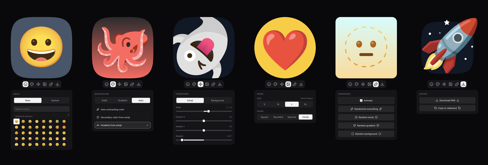

# Emoji Profile Pic

Turn any emoji into a polished profile picture — with automatic color matching, gradients, transforms, and one-click export.



## 🌐 Website

Try it live at **https://avatars.etienne.tech**

## ✨ Features

- **Pick any emoji** — from a curated library of fun emojis (smilies, animals, food, objects, and more).
- **Smart auto backgrounds** (`Auto` tab):
  - **Auto contrasting color** — analyzes the emoji and picks a complementary color that pops.
  - **Secondary color** — extracts a color from the emoji itself to use as the background.
  - **Gradient from emoji** — builds a gradient from the emoji's own palette, and you can rotate it.
- **Solid colors** — a curated palette plus a full color picker (saturation/hue) and direct hex input.
- **Gradients** — a rich set of preset gradients with adjustable angle.
- **No background** — transparent export when you don't want a backdrop.
- **Transforms** — scale, position, rotate, and background scale.
- **Shapes** — square, rounded, circle, and squircle clipping, with adjustable corner radius.
- **Two renderers** — self-hosted **Noto Color Emoji** font or your **system** emoji font.
- **Export** — download or copy a PNG at your chosen resolution.

## 🖼️ How it works

1. **Pick an emoji** from the library (or randomize one).
2. **Choose a background** — a solid color, gradient, or one of the auto/magic options that reads the emoji's pixels and derives a matching color.
3. **Tune the look** — shape, transform, and whether to crop the emoji to the shape.
4. **Export** — download the result as a PNG or copy it straight to your clipboard.

Everything is rendered locally in your browser using the HTML5 Canvas API — no uploads, no server processing. When you pick an "auto" background, the app renders the emoji offscreen, samples its colors, and generates a complementary gradient/color on the fly.

## 🚀 Development

A Vite+ + React + Tailwind single-page app.

```sh
pnpm dev      # start the dev server (vp dev)
pnpm build    # type-check and build the production bundle to ./dist
pnpm check    # format, lint, type-check (vp check)
```

## 🏷️ Release

Bump the version and trigger a deployment with **bumpp** — it runs the checks, then
commits, tags and pushes in one interactive step (choose patch/minor/major or a version):

```sh
pnpm release   # -> bumps version, runs checks, commits chore: release vX.Y.Z, tags vX.Y.Z, pushes
```

The push to `main` publishes the Docker image tagged with the new version (and `latest`).

## 🐳 Deployment

The app is a static site. A `Dockerfile` builds it (with the official Vite+ toolchain image) and serves it with **Caddy** (with SPA fallback), and a GitHub Actions workflow pushes the image to **GHCR** tagged by the version in `package.json` on every push to `main`.

```sh
docker build -t emoji-profile-pic .   # build the image locally
```
